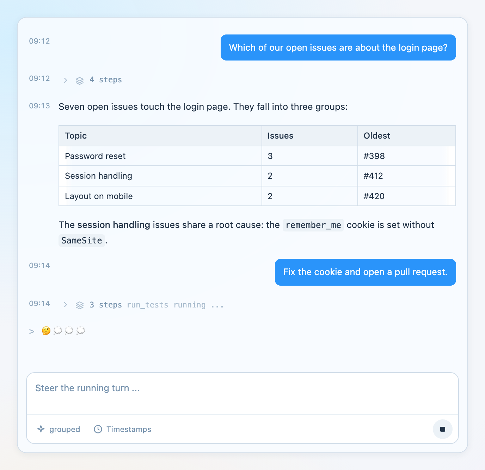
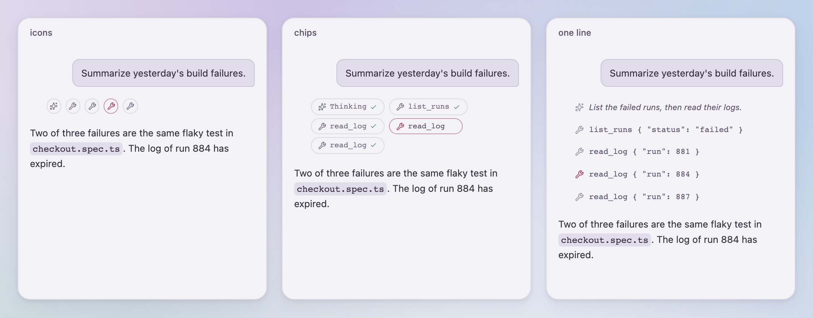
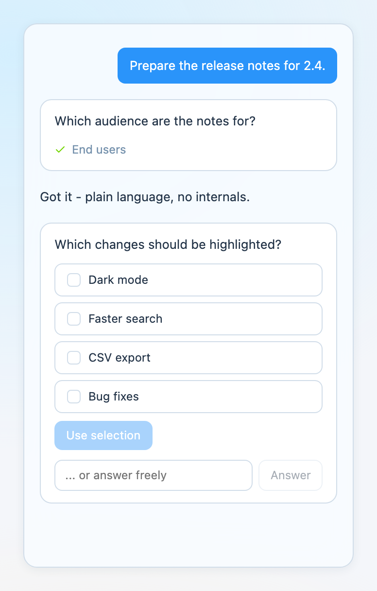
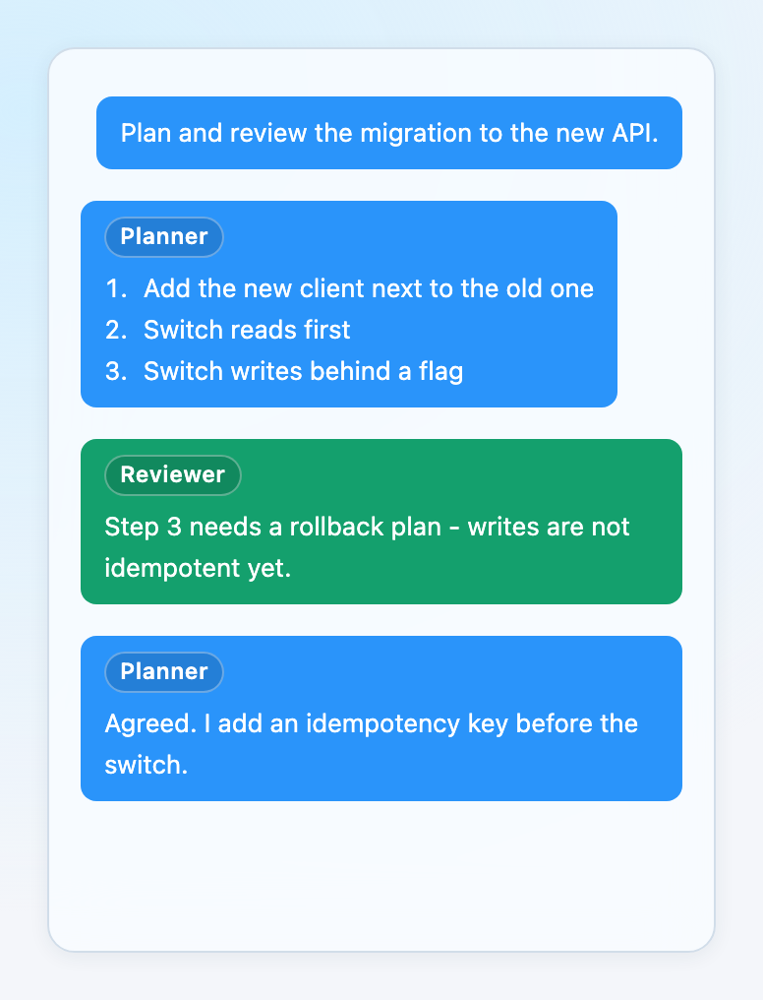
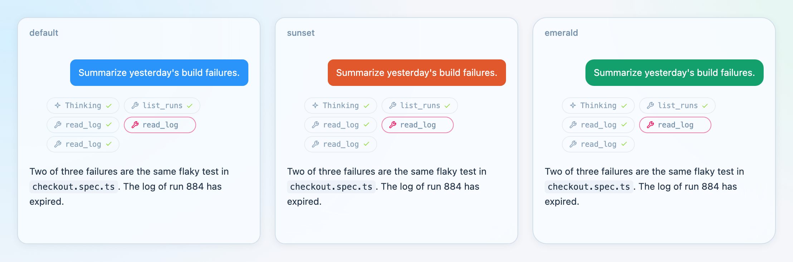
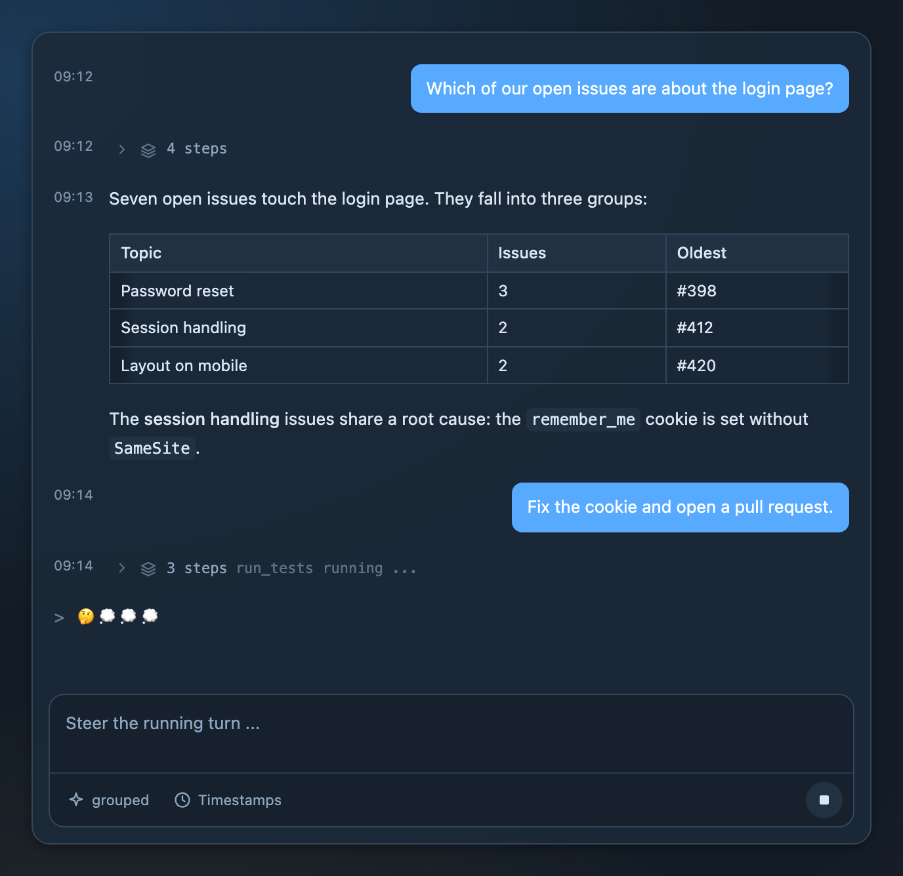

# quassel

Chat building blocks for React: a streaming transcript with thinking and tool steps, pending
actions, an input card with attachments and steering, and a small event contract that works
on the server as well. quassel is the chat of [RAgents](https://github.com/SchlenkR/RAgents),
published as a library. It ships a compiled stylesheet, so hosts need no Tailwind, and every
color, radius, font and font size is a `--qsl-*` variable, with compact defaults for text and tool steps.



## What you can build

**Agent chats that show their work.** Thinking and tool calls appear as steps. Pick how much
of them the user sees - only the current step, icons, chips, a collapsible group, single lines
or everything - and let them switch at runtime. A tool call that runs longer than a few seconds
shows how long it has been running, on its row and on the collapsed group header, so a slow step
does not look like a hung one.



**Pending actions.** The agent waits for input: a generic card with dismiss, or the host's own
rendering per action owner. Open actions sit right above the input, like a question in a terminal
agent; resolved actions stay in the transcript as a record.

**Multi-party conversations.** Colored bubbles with labels for agents that talk to each other.

<p>
  
  
</p>

**Your look, not a fork.** Override `--qsl-*` variables on any wrapper, switch light and dark
with `data-theme`, or hand quassel your own Button, Toggle, Card and Popover components. With
`portalContainer` on `QuasselProvider`, popovers render inside your wrapper and pick up its
variables too.





## Highlights

- Streaming-safe Markdown (tables, code with copy button, lists) via Streamdown.
- Steering: typing while a turn runs sends into it; stop, retry and failed-send recovery built in.
- Attachments by button, drag and drop or paste, with previews and size limits.
- Condensed conversation: all user inputs and the latest answer between them, independently of tool/thinking detail.
- Timestamps, day separators, message actions, configurable bubbles and appearance.
- Screen reader friendly: the transcript is not a live region; finished replies and new
  actions are announced once, with the host in control of the wording.
- Complete English and German UI labels through `englishTexts` / `germanTexts`; `texts` can override any label (English by default).
- Grouped steps show their error count even while collapsed.
- One text size per host, a fixed small size and shared Markdown typography (see below).

## Install

```sh
npm install @schlenkr/quassel
```

Up to 0.4.9 the package was published without scope as `quassel`; from 0.5.0 on it is `@schlenkr/quassel` with the same API.

| Import | Contents |
|---|---|
| `@schlenkr/quassel` | React components, `QuasselProvider`, types, texts, `announce`, `markdownPlainText` |
| `@schlenkr/quassel/events` | The event contract, the pure reducer `applyEvent` and the attachment limits, without React |
| `@schlenkr/quassel/chat.css` | The compiled stylesheet: theme variables, scoped reset and all utilities quassel uses |

```tsx
import { useReducer, useState } from "react";
import { applyEvent, ChatInputToolbar, ChatMessages, ChatPanel, type Message } from "@schlenkr/quassel";
import "@schlenkr/quassel/chat.css";

export function Chat({ send, stop }: { send: (text: string) => Promise<void>; stop: () => void }) {
  const [messages, dispatch] = useReducer(applyEvent, [] as Message[]);
  const [running, setRunning] = useState(false);
  // feed your backend's ChatEvent stream into dispatch(event) and setRunning(event.running) on "status"
  return (
    <ChatPanel composer={<ChatInputToolbar onSend={send} onStop={stop} running={running} rows={1} />}>
      <ChatMessages messages={messages} running={running} detailMode="grouped" />
    </ChatPanel>
  );
}
```

```css
.my-chat {
    --qsl-primary: #11855c;
    --qsl-radius: 0.9rem;
}
```

Any backend that emits the `@schlenkr/quassel/events` stream works with the same components.

## Text size

quassel defaults to 13px. Set `--qsl-font-size` on a wrapper, or `1em` to inherit the host's
font size. Messages, the composer, action cards and text buttons use that base with line height
1.5. All small UI text, including tools and timestamps, uses 85% with line height 1.4.
`--qsl-font` and `--qsl-mono` select the font families. There are no other typography inputs.
Sizes derive from an absolute base, so nested small elements never compound.

`Markdown` uses the same typography in answers and standalone documents:

```tsx
<Markdown text={documentText} />
```

User message backgrounds fill the available row by default while text keeps its width and
alignment. `bubbleOptions={{ userBackgroundFullWidth: false }}` restores a fitted background.
Timestamps sit beside messages by default; `timestampOptions={{ position: "above" }}` moves
them above. Message gaps and tool row spacing remain configurable through `appearance`.

For 0.6, replace separate size and line-height overrides with `--qsl-font-size` and remove
all typography fields from `appearance` and timestamp options. The [migration guide](docs/guide.md#migration-to-06)
lists the removed variables and options.

## Development

```sh
pnpm install
pnpm dev              # stylesheet in watch mode plus the gallery on http://localhost:3210
pnpm check            # type check package and gallery
pnpm test             # package tests (node:test with happy-dom)
pnpm build            # stylesheet and gallery build
pnpm release --dry-run
```

The full guide - every prop, the event contract, theming, slots, dark mode and publishing -
is in [docs/guide.md](docs/guide.md). It is written so that an AI assistant can build
an application with quassel from it.

## License

[MIT](LICENSE)
